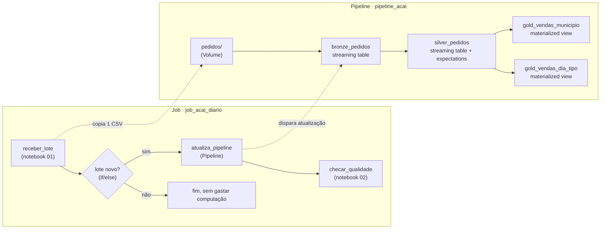
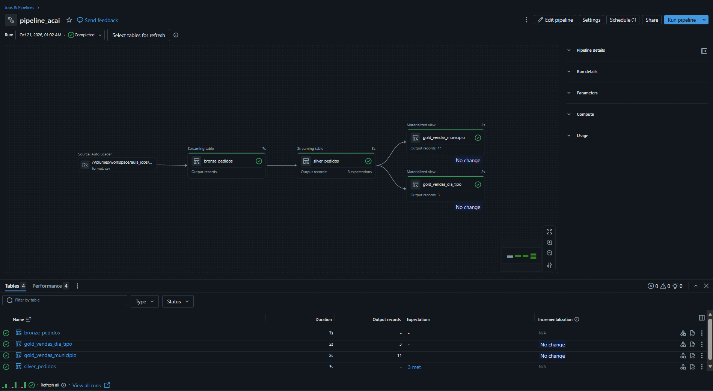
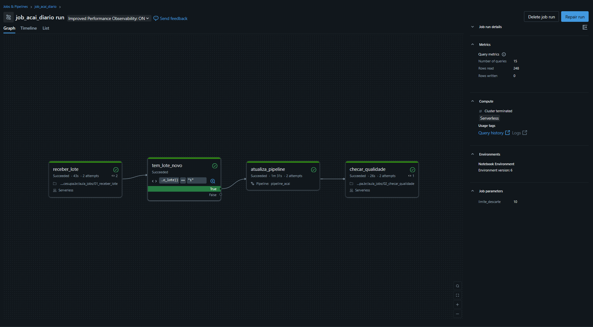
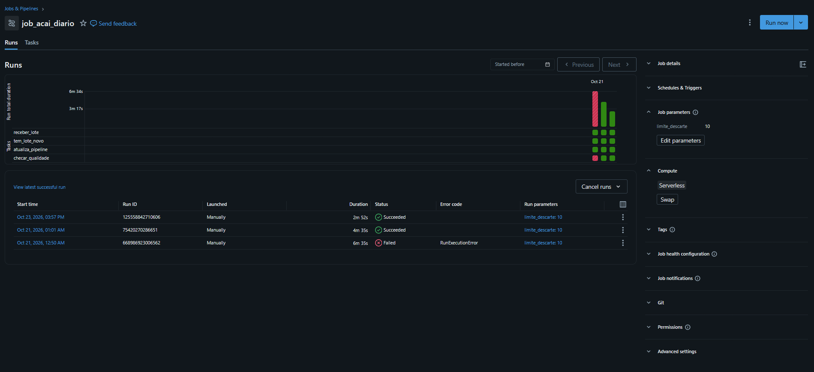

# 🫐 Açaí · Jobs e Pipelines no Databricks

Pipeline de dados **bronze → silver → gold** com ingestão incremental, orquestrado por um **job** que só atualiza o pipeline quando chega um lote novo e **barra lotes com qualidade ruim**. Tudo construído no **Databricks Free Edition**.


> Projeto prático da disciplina de Plataformas de Dados e IA com Databricks (CESUPA, 2026.2).
> Pipeline e notebooks-base fornecidos pelo **Prof. Isaac Souza Elgrably**; a montagem, a execução, a investigação do lote com problema e a documentação são minhas.

---

## 📌 O caso

Uma cooperativa fictícia de açaí recebe, todo dia, um CSV com os pedidos dos pontos de venda de **10 municípios do Pará**. São 3 lotes diários (14, 15 e 16/10/2026), com 120, 130 e 140 pedidos. Um deles chega com dados ruins, e o fluxo precisa detectar isso sozinho.

## 🏗️ Arquitetura



**Divisão de responsabilidades:** o **pipeline** define *como* os dados mudam (tabelas, transformações, regras de qualidade); o **job** define *quando* e *em que ordem* as coisas rodam (tarefas, dependências, decisões, agendamento).

## 🧱 Camadas do pipeline

| Tabela | Tipo | O que faz |
|---|---|---|
| `bronze_pedidos` | Streaming table | Lê cada CSV uma única vez (Auto Loader, `STREAM read_files`) e registra o arquivo de origem em `arquivo_origem` |
| `silver_pedidos` | Streaming table | Limpa o município, calcula `valor_total` e aplica 4 regras de qualidade |
| `gold_vendas_municipio` | Materialized view | Vendas agregadas por município |
| `gold_vendas_dia_tipo` | Materialized view | Vendas agregadas por dia e tipo de açaí |

### Regras de qualidade (expectations) na silver

| Regra | Ação | Efeito |
|---|---|---|
| `pedido_com_id` | `DROP ROW` | descarta a linha e conta a violação |
| `quantidade_valida` | `DROP ROW` | descarta quantidade nula ou ≤ 0 |
| `preco_valido` | `DROP ROW` | descarta preço inválido |
| `municipio_informado` | *warn* (padrão) | a linha **segue** adiante e a violação é contada; vai para o grupo "Não informado" na gold |

Optei por não usar `FAIL UPDATE`: uma única linha ruim derrubaria o lote inteiro. Descartar, medir o percentual e deixar o job decidir é mais flexível.

## ⚙️ O job `job_acai_diario`

| # | Tarefa | Tipo | Função |
|---|---|---|---|
| 1 | `receber_lote` | Notebook | Copia o próximo CSV da pasta `chegada/` para `pedidos/` e publica o *task value* `novo_lote` (1 ou 0) |
| 2 | `tem_lote_novo` | If/else | Condição: `{{tasks.receber_lote.values.novo_lote}} == 1` |
| 3 | `atualiza_pipeline` | Pipeline | Atualiza bronze, silver e gold só com o arquivo novo |
| 4 | `checar_qualidade` | Notebook | Calcula o percentual de linhas descartadas do lote e **falha** se passar de `limite_descarte` |

- **Parâmetro do job:** `limite_descarte = 10` (%), lido pelo notebook como widget.
- **Task values:** `receber_lote` avisa as tarefas seguintes qual lote chegou e se há lote novo.
- **Gatilho:** agendamento diário às 06:00 (`America/Belem`), deixado **pausado** por causa da cota do Free Edition.

## 📊 Contagens esperadas após cada lote

| Após o lote | Bronze | Silver | Descartadas no lote |
|---|---|---|---|
| 14/10 | 120 | 117 | 3 (2,5%) |
| 15/10 | 250 | 242 | 5 (3,8%) |
| 16/10 | 390 | 361 | 21 (15,0%) |

O lote de 16/10 ultrapassa o limite de descarte de 10% definido no job (`limite_descarte`), e por isso o `checar_qualidade` o reprova.

- **Causa:** o município **Igarapé-Miri** passou a enviar estornos como quantidade negativa (16 linhas do lote), violando a regra `quantidade_valida`.
- - **Investigação:** conferi as métricas de qualidade da `silver_pedidos` no pipeline e consultei a bronze filtrando por `arquivo_origem` e agrupando por município.
- **Decisão:** como os estornos devem mesmo ser descartados, o lote foi aceito.
- **Correção:** **Repair run** com `limite_descarte = 20`. Só a tarefa `checar_qualidade` rodou de novo: o lote não foi copiado outra vez e o pipeline não reprocessou nada.

## 🖼️ Capturas de tela

| Pipeline | Job | Execuções |
|---|---|---|
|  |  |  |

## 💡 Aprendizados

- **Streaming table x materialized view:** a streaming table lembra quais arquivos já leu, então reexecutar o pipeline sem lote novo não duplica nada; a materialized view recalcula o resultado a cada atualização.
- **Warn x drop:** onde a regra é declarada (`CONSTRAINT … EXPECT … ON VIOLATION DROP ROW`) decide se a linha ruim segue ou não para a gold.
- **Qualidade como parte da orquestração:** medir o descarte e barrar o lote evita que relatórios sejam gerados com dados suspeitos.
- **Repair run:** refaz só o que falhou, sem reprocessar o que já deu certo.
- **If/else com task values:** evita gastar computação quando não há dado novo.

## 🚧 Limites do Free Edition considerados

- Apenas computação **serverless**.
- Até 5 tarefas de job simultâneas (o job tem 4, em sequência).
- 1 pipeline ativo por tipo: não rodar o pipeline no editor enquanto o job está executando.
- Cota diária de uso (por isso o agendamento fica pausado).
- Sem DBFS: arquivos em **Volumes** do Unity Catalog (`/Volumes/workspace/aula_jobs/...`).

## 📁 Estrutura do repositório

```
.
├── README.md
├── pipeline/
│   └── pipeline_acai.sql           # bronze → silver → gold
├── notebooks/
│   ├── 00_preparar_ambiente.ipynb  # esquema, volume e conferência do upload
│   ├── 01_receber_lote.ipynb       # tarefa 1 do job
│   └── 02_checar_qualidade.ipynb   # tarefa 4 do job
├── dados/
│   ├── pedidos_2026-10-14.csv
│   ├── pedidos_2026-10-15.csv
│   └── pedidos_2026-10-16.csv
└── imagens/
```

## ▶️ Como reproduzir

1. Crie uma conta no [Databricks Free Edition](https://www.databricks.com/learn/free-edition).
2. Importe os notebooks para o seu workspace e rode `00_preparar_ambiente` (cria `workspace.aula_jobs` e o volume `arquivos`).
3. Envie os 3 CSVs de `dados/` para `/Volumes/workspace/aula_jobs/arquivos/chegada/`.
4. Crie o pipeline `pipeline_acai` (catálogo `workspace`, esquema `aula_jobs`) com o conteúdo de `pipeline/pipeline_acai.sql`.
5. Crie o job `job_acai_diario` com as 4 tarefas da tabela acima (use exatamente esses nomes) e o parâmetro `limite_descarte = 10`.
6. Execute com **Run now** e acompanhe a aba **Runs**.

## 🔭 Próximos passos

- [ ] Trocar o agendamento por um gatilho **File arrival** na pasta `chegada/`
- [ ] Adicionar alertas de falha por e-mail no job
- [ ] Criar uma terceira visão gold (ex.: ticket médio por município)

## 🙏 Créditos

Atividade proposta pelo **Prof. Isaac Souza Elgrably** (CESUPA, 2026.2), que forneceu o pipeline-base, os notebooks e os dados fictícios.

---

**Mateus Sousa Castelo Branco** · Engenharia de Computação, CESUPA
[GitHub](https://github.com/mateusscb) · [LinkedIn](https://www.linkedin.com/in/mateus-castelo-branco/?isSelfProfile=true)
